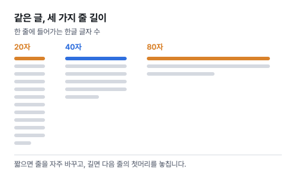
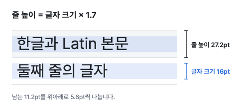
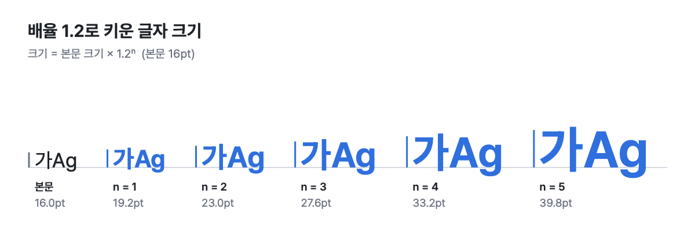

###### 요약

긴 글을 화면에서 편하게 읽으려면 글꼴보다 먼저 정해야 하는 값이 있습니다. 한 줄의 길이, 줄과 줄 사이의 거리, 줄을 끊는 자리입니다. 이 글은 한글과 영문이 섞인 문서를 기준으로 세 값을 어떻게 정하는지 설명합니다. 결론부터 적으면 다음과 같습니다.

- 한 줄의 길이는 한글 35~45자, 영문 60~75자
- 줄 높이는 글자 크기의 1.6~1.75배
- 줄은 어절 단위로 끊기

제목의 크기는 일정한 배율로 키우고, 제목 위의 여백을 아래보다 넓게 둡니다. 뒤쪽에서는 이 값들을 표와 코드 블록, 라이트·다크 테마에 어떻게 이어 붙이는지도 다룹니다.

## 1 들어가며

같은 글이라도 어떻게 놓느냐에 따라 읽는 속도와 피로가 달라집니다. 종이책은 판형과 여백이 정해져 있어서 조판을 한 번만 하면 됩니다. 화면은 그렇지 않습니다. 창의 폭이 수시로 바뀌고, 독자가 글자 크기를 바꾸고, 밝은 배경과 어두운 배경을 오갑니다. 그래서 화면용 조판은 고정된 치수가 아니라 서로 묶인 비율의 집합으로 적어 두는 편이 낫습니다. 본문 글자 크기 하나를 정하면 줄 길이와 줄 높이, 제목 크기, 여백이 그 값을 따라 함께 움직이게 하는 것입니다.

마크다운 문서는 이 문제가 더 두드러집니다. 마크다운은 내용의 구조만 적고 모양은 읽는 프로그램에 맡깁니다. 같은 `README.md`가 어떤 프로그램에서는 창 폭을 가득 채운 긴 줄로, 다른 프로그램에서는 좁은 단으로 보입니다. 한글 문서라면 낱말 가운데에서 줄이 끊기는 일도 흔합니다. 문법은 같아도 읽는 경험은 프로그램마다 크게 다릅니다.

> 이 글의 질문은 하나입니다. 한글과 영문이 섞인 긴 글을 화면에서 오래 읽어도 피곤하지 않게 하려면, 무엇을 얼마로 정해야 하는가?

아래의 값은 mdr라는 읽기 전용 마크다운 리더를 만들면서 실제 화면에 놓고 잰 결과에 바탕을 둡니다. 인쇄 조판의 오랜 경험칙[^1]과 웹 접근성 지침[^2]을 출발점으로 삼았고, 맞지 않는 부분은 재서 고쳤습니다. 숫자 자체보다 숫자를 정한 이유가 더 오래 쓸모 있으므로, 절마다 이유를 함께 적습니다.

## 2 줄 길이

### 2-A 한 줄에 몇 글자가 알맞은가

줄이 너무 길면 줄 끝에서 다음 줄의 첫머리로 돌아올 때 눈이 길을 잃습니다. 방금 읽은 줄을 다시 읽거나 한 줄을 건너뛰게 됩니다. 반대로 줄이 너무 짧으면 눈이 쉴 틈 없이 줄을 바꿔야 하고, 문장이 잘게 토막 나서 뜻의 덩어리를 잡기 어렵습니다. 알맞은 줄 길이는 이 두 불편 사이의 어딘가에 있습니다.



영문 조판에서는 한 줄에 45~75자가 알맞고 66자 안팎이 가장 편하다는 경험칙이 널리 쓰입니다. 여기서 글자 수는 낱말 사이의 빈칸을 포함해 셉니다. 웹 접근성 지침의 가장 높은 등급은 한 줄을 80자 이하로, 한중일 문자는 40자 이하로 두라고 권합니다. 두 기준을 겹쳐 보면 영문은 60~75자, 한글은 35~45자라는 범위가 나옵니다.

### 2-B 한글과 영문은 기준이 다르다

한글의 기준이 영문의 절반쯤인 까닭은 글자 하나가 담는 정보와 차지하는 폭이 다르기 때문입니다. 한글은 초성·중성·종성을 네모 하나에 모아 쓰므로 한 글자가 한 음절입니다. 영문은 한 음절을 적는 데 보통 두세 글자가 듭니다. 그리고 한글 글자는 폭이 거의 일정하고 영문 소문자보다 넓습니다. 같은 폭의 줄에 한글은 영문의 60% 남짓만 들어갑니다.

그래서 한글 문서와 영문 문서에 같은 본문 폭을 쓰면 한쪽은 반드시 어긋납니다. 영문에 맞춰 폭을 잡으면 한글은 한 줄에 50자를 넘기고, 한글에 맞추면 영문은 줄이 짧아져 자주 끊깁니다. mdr는 문서의 앞부분에서 한글 음절의 비율을 세어 문서를 한글 문서와 영문 문서로 가르고, 본문 폭을 따로 씁니다. 문단마다 가르지 않는 이유는 한 문서 안에서 줄 길이와 줄 간격이 들쭉날쭉해지면 오히려 읽기 어렵기 때문입니다.

#### 글자 수를 세는 방법

한 줄의 글자 수는 문단마다, 줄마다 다릅니다. 그래서 값 하나가 아니라 분포로 봐야 합니다. 들여쓰지 않은 본문 문단에서 줄바꿈으로 끝난 줄만 모으고, 문단의 마지막 줄은 뺍니다. 마지막 줄은 문장이 끝나서 짧은 것이지 폭 때문에 짧은 것이 아니기 때문입니다. 그렇게 모은 줄들의 중앙값과 10%·90% 지점을 봅니다. 중앙값만 범위 안에 있고 양 끝이 벗어나면 줄 길이가 고르지 않다는 뜻입니다.

##### em 단위로 폭을 정하는 이유

본문 폭을 pt나 px로 적으면 글자 크기를 바꿀 때마다 한 줄의 글자 수가 달라집니다. 글자를 키우면 줄이 짧아지고, 줄이면 길어집니다. 폭을 본문 글자 크기의 배수인 em으로 적으면 글자 크기가 바뀌어도 한 줄의 글자 수는 그대로입니다. 독자가 글자를 125%로 키워도 줄 길이의 감각은 같고, 본문이 차지하는 폭만 넓어집니다.

###### 실제로 잰 값

본문 16pt에서 한글 문서의 폭을 31em으로 두면 한 줄의 중앙값이 42자 안팎입니다. 영문 문서는 34em에서 70자 안팎입니다. 처음에는 영문 문서의 폭을 조금 더 넓게 잡았는데, 긴 줄이 범위를 넘어서 줄였습니다. 계산으로 정한 값도 화면에 놓고 재 보면 조금씩 어긋납니다. 숫자나 영문이 몰린 줄은 글자의 폭이 좁아서 같은 폭에 더 많은 글자가 들어간다는 점도 재 보고서야 알았습니다.

### 2-C 본문 폭을 가운데에 두기

폭을 제한하면 넓은 창에서는 좌우에 빈 자리가 생깁니다. 본문을 왼쪽에 붙이면 오른쪽만 크게 비어 시선이 한쪽으로 쏠리므로, 본문 단을 창의 가운데에 둡니다. 이때 가운데의 기준은 창 전체가 아니라 본문 영역입니다. 목차 사이드바가 열려 있으면 사이드바를 뺀 나머지의 가운데에 놓습니다.

빈 자리는 낭비가 아닙니다. 여백은 본문과 창 가장자리를 떼어 놓아 글에 시선을 모으고, 넓은 표나 그림이 필요할 때 빌려 쓸 수 있는 자리가 됩니다. 이 글 뒤쪽의 넓은 표가 그렇게 여백을 씁니다.

## 3 행간

### 3-A 줄 높이와 글자 크기

행간은 한 줄의 기준선에서 다음 줄의 기준선까지의 거리입니다. 화면 조판에서는 보통 줄 높이라고 부르고 글자 크기의 배수로 적습니다. 16pt 글자에 1.7배를 주면 줄 높이는 27pt쯤입니다. 줄 높이에서 글자 크기를 뺀 나머지는 줄 사이의 빈 띠가 됩니다. 이 띠가 줄과 줄을 갈라 주어서, 눈이 한 줄을 따라가다 위아래 줄로 미끄러지지 않습니다.



줄 길이와 행간은 따로 정할 수 없습니다. 줄이 길수록 다음 줄의 첫머리를 찾기 어려우므로 행간을 넓혀야 하고, 줄이 짧으면 조금 좁혀도 됩니다. 신문의 좁은 단이 촘촘한 행간으로도 읽히는 것이 그 예입니다.

### 3-B 한글에 더 넓은 행간이 필요한 까닭

영문 소문자는 대부분 글자 상자의 가운데 절반쯤만 씁니다. `a`, `e`, `o` 같은 글자는 키가 낮고, `b`나 `p`만 위아래로 튀어나옵니다. 그래서 줄 높이를 좁게 잡아도 줄 사이에 저절로 빈 자리가 생깁니다. 한글은 다릅니다. 글자마다 네모 상자를 거의 가득 채우고, 받침이 있는 글자는 아래쪽까지 꽉 찹니다. 같은 줄 높이라면 한글 쪽이 훨씬 빽빽해 보입니다.

접근성 지침은 문단 안의 줄 간격을 글자 크기의 한 배 반 이상으로 두라고 권합니다. 영문 본문은 그 정도면 넉넉하지만, 한글 본문은 그보다 넓어야 비슷한 여유가 생깁니다. mdr는 한글 문서에 1.7배를, 영문 문서에는 그보다 조금 좁은 값을 씁니다. 한글 문서 안에 영문 문단이 섞여 있어도 문서 전체에 같은 값을 써서 줄 간격을 고르게 유지합니다.

### 3-C 남는 높이를 위아래로 나누기

줄 높이를 고정하면 글자 위아래에 남는 높이를 어디에 둘지 정해야 합니다. 웹 브라우저는 남는 높이를 절반씩 나눠 글자의 위와 아래에 둡니다. 이렇게 하면 글자가 줄 상자의 세로 가운데에 놓이고, 문단의 첫 줄 위와 마지막 줄 아래에 같은 크기의 여백이 붙습니다. 16pt 글자에 27pt 줄 높이라면 위아래로 5.5pt씩입니다.

Apple 플랫폼의 글자 배치는 기본 동작이 다릅니다. 줄 높이의 최솟값과 최댓값을 같은 값으로 고정하면 남는 높이가 모두 글자 위쪽에 붙어서, 글자가 줄 상자의 아래쪽으로 치우칩니다. 기준선을 옮겨 가운데로 올리는 방법은 TextKit 2에서 줄 높이 자체를 줄여 버려 쓸 수 없었습니다. 대신 남는 높이의 절반만큼 문단 위 간격을 줄이고 아래 간격을 늘려, 문단 전체를 위로 당기는 방식으로 같은 결과를 얻습니다.

토큰 파일에서는 이 값들을 다음처럼 적습니다. 단위가 붙지 않은 숫자는 모두 글자 크기에 대한 배수입니다.

```json
{
  "baseSize": 16,
  "scale": 1.2,
  "measure": { "hangul": 31, "latin": 34 },
  "body": {
    "lineHeight": { "hangul": 1.7, "latin": 1.6 },
    "paragraphSpacing": 0.9,
    "lineBreak": "hangulWord"
  }
}
```

## 4 줄바꿈

### 4-A 어절 단위로 끊기

한글 문장은 어절 단위로 띄어 씁니다. 어절은 낱말에 조사나 어미가 붙은 덩어리이고, 읽을 때 눈이 한 번에 잡는 단위이기도 합니다. 줄이 어절 가운데에서 끊기면 "읽습/니다"처럼 덩어리가 두 줄로 갈라져, 앞 조각만으로는 뜻을 알 수 없고 다음 줄을 본 뒤에야 이어 붙이게 됩니다. 한두 번은 괜찮지만 긴 글에서 줄마다 되풀이되면 읽는 흐름이 계속 끊깁니다.

글자 단위 줄바꿈이 틀린 방식은 아닙니다. 양끝을 맞추는 인쇄 조판에서는 글자 단위로 끊어야 오른쪽 끝이 가지런하고 글자 사이가 벌어지지 않습니다.[^3] 그러나 화면의 본문은 대개 왼쪽만 맞추고 오른쪽은 흘립니다. 오른쪽을 맞출 필요가 없다면 어절을 지키는 쪽이 읽기에 낫습니다. 웹 브라우저와 Apple 플랫폼은 모두 이 동작을 켜는 설정을 갖추고 있습니다.[^4]

### 4-B 영문·숫자와 한글이 맞닿은 자리

어절 단위 줄바꿈을 켜도 빠지는 자리가 있습니다. 기술 문서에는 영문 낱말이나 숫자 바로 뒤에 조사가 붙는 어절이 많습니다. "API는"이나 "3단계"가 그렇습니다. 줄바꿈 규칙은 한글과 한글 사이만 붙여 두기 때문에, 영문과 한글이 맞닿은 자리에서는 여전히 줄을 끊을 수 있다고 봅니다. 그 결과 줄 끝에 "API"만 남고 조사 "는"이 다음 줄의 첫머리로 떨어집니다.

이런 자리는 생각보다 자주 나옵니다. 다음과 같은 경우입니다.

- 영문 낱말 뒤의 조사: `README`를, `Swift`로, `macOS`에서
- 숫자 뒤의 단위와 조사: 45자, 1.7배, 2단계에서는, 16pt의
- 괄호나 따옴표를 낀 어절: (iOS에, "제목"을
- 인라인 코드 뒤의 조사: `lineHeight`가, `measure`는
    - 인라인 코드는 배경 상자가 있어서, 조사만 떨어지면 더 눈에 띕니다.
    - 표의 칸처럼 폭이 좁은 곳에서 특히 자주 생깁니다.

mdr는 줄을 끊으려는 자리마다 앞뒤 글자를 확인해, 빈칸이 아닌데 한글과 영문·숫자가 맞닿아 있으면 그 자리에서 끊지 않습니다. 어절이 통째로 다음 줄로 넘어갑니다. 이 규칙을 켜기 전후를 같은 문서로 세어 보면 차이가 분명합니다. 규칙이 전혀 없을 때는 거의 모든 줄바꿈이 어절 가운데에서 일어나고, 시스템의 한글 규칙만 켜면 몇 건이 남고, 맞닿은 자리까지 막으면 0건이 됩니다.

### 4-C 줄보다 긴 낱말

끊지 않는다는 규칙에는 예외가 필요합니다. 긴 URL이나 수십 글자짜리 식별자는 낱말 하나가 줄 전체보다 길 수 있습니다. 본문 폭에서는 드물지만, 표의 좁은 칸에서는 흔합니다. 이때도 끊기를 거절하면 글자가 칸 밖으로 넘치거나 잘립니다. 그래서 낱말이 줄보다 길 때에만 낱말 안에서 끊습니다. 검증할 때는 이런 줄바꿈을 따로 세어, 규칙이 지켜지지 않은 경우와 구별합니다.

1. 먼저 빈칸에서 끊을 수 있는지 봅니다.
2. 빈칸이 없으면 문장부호 뒤처럼 끊어도 되는 자리를 찾습니다.
3. 그것도 없고 낱말이 줄보다 길면 낱말 안에서 끊습니다.
    1. 영문은 음절 경계를 알 수 없으므로 글자 사이에서 끊습니다.
    2. 한글은 글자 사이 어디든 음절 경계입니다.

## 5 크기와 간격의 체계

### 5-A 제목 크기와 배율

제목은 본문보다 커야 하지만, 얼마나 커야 하는지는 감으로 정하기 쉽습니다. 단계마다 크기를 따로 고르면 2단계와 3단계의 차이는 큰데 3단계와 4단계는 거의 같은 식으로 간격이 고르지 않게 됩니다. 한 가지 배율을 정하고 단계마다 그 배율을 곱해 나가면 크기 사이의 관계가 일정해집니다. 이런 크기 체계를 modular scale이라고 부릅니다.[^5]



본문 중심의 문서에는 1.2 안팎의 작은 배율이 알맞습니다. 큰 배율은 단계 사이의 차이가 뚜렷해서 포스터나 첫 화면에는 좋지만, 제목이 여섯 단계까지 있는 문서에서는 가장 큰 제목이 지나치게 커집니다. 배율 1.2라면 다섯 단계 위의 제목이 본문의 두 배 반쯤이지만, 완전4도 배율이라면 네 배를 넘습니다. 한글 제목은 같은 크기의 영문 제목보다 무겁게 보이므로 작은 배율이 더 잘 맞습니다.

가장 낮은 단계의 제목은 본문과 크기가 같거나 조금 작아도 됩니다. 크기 대신 굵기와 색, 위쪽 여백으로 제목임을 알립니다. 이 글 맨 앞의 "요약"과 2절의 "실제로 잰 값"이 여섯째 단계의 제목입니다.

### 5-B 제목 위아래 여백

제목은 뒤따르는 내용에 속합니다. 그러니 제목은 앞 문단보다 뒤 문단에 가까이 있어야 합니다. 제목 위의 여백을 아래 여백의 두 배쯤으로 두면, 제목과 그 아래 본문이 한 덩어리로 보이고 앞 절과는 떨어져 보입니다. 위아래 여백이 같으면 제목이 두 절 사이에 떠 있는 것처럼 보여서, 어느 쪽에 속하는지 한눈에 들어오지 않습니다.

### 5-C 블록 사이 간격

문단, 목록, 인용문, 표, 코드 블록은 저마다 위아래 여백을 가집니다. 두 블록이 만나는 자리에서 두 여백을 더하면 간격이 지나치게 벌어집니다. 웹의 방식대로 둘 중 큰 쪽 하나만 쓰면 간격을 예상하기 쉽습니다. 제목 위 여백을 2em으로 적었다면, 앞에 무엇이 오든 화면에서 제목 위는 2em입니다.

간격의 크기에도 순서가 있습니다. 좁은 것부터 적으면 다음과 같습니다.

1. 문단 안의 줄과 줄 사이
2. 목록의 항목과 항목 사이
3. 문단과 문단 사이
4. 본문과 그 아래 제목 사이

가까운 것끼리 묶여 보인다는 원리를 그대로 따른 순서입니다. 순서가 뒤집히면, 예를 들어 줄 사이가 문단 사이보다 넓으면 어디서 문단이 바뀌는지 알아보기 어렵습니다.

## 6 표와 코드

### 6-A 좁은 표

표는 본문과 같은 글자 크기와 줄바꿈 규칙을 써야 합니다. 표 안에서만 낱말이 아무 데서나 끊기면 본문에서 지킨 규칙이 무색해집니다. 열이 적은 표는 본문 폭 안에 그대로 넣고, 열의 폭은 내용의 길이에 맞춰 나눕니다.

| 요소 | 한글 문서 | 영문 문서 |
| --- | --- | --- |
| 본문 폭 | 31em | 34em |
| 한 줄 글자 수 | 35~45자 | 60~75자 |
| 줄 높이 | 1.7배 | 1.6배 |

### 6-B 넓은 표

열이 많은 표를 본문 폭에 가두면 칸마다 일고여덟 글자밖에 들어가지 않아 세로로 길게 늘어납니다. 이런 표는 본문 폭을 가운데에 둔 채 좌우 여백까지 넓혀 씁니다. 그래도 넘치면 표만 가로로 스크롤하고, 더 있는 쪽 가장자리를 흐리게 해서 내용이 이어진다는 것을 알립니다. 아래 표는 일부러 열을 많이 두었습니다.

| 조판 요소 | 정하는 값 | 한글 문서의 기준 | 영문 문서의 기준 | 너무 작을 때 | 너무 클 때 | 확인하는 방법 |
| --- | --- | --- | --- | --- | --- | --- |
| 줄 길이 | 본문 폭(em) | 한 줄 35~45자가 되도록 31em 안팎으로 둡니다. | 한 줄 60~75자가 되도록 34em 안팎으로 둡니다. | 줄을 너무 자주 바꾸게 되어 문장이 토막 납니다. | 줄 끝에서 다음 줄의 첫머리를 찾기 어렵습니다. | 본문 줄의 글자 수를 모아 중앙값과 10%·90% 지점을 봅니다. |
| 행간 | 줄 높이(배수) | 글자 크기의 1.6~1.75배. 글자가 상자를 가득 채우므로 넓게 둡니다. | 글자 크기의 1.5~1.6배면 넉넉합니다. | 위아래 줄이 붙어 보여 줄을 따라가다 놓칩니다. | 줄들이 흩어져 문단이 한 덩어리로 보이지 않습니다. | 실제로 배치된 줄의 높이를 재서 토큰의 값과 같은지 봅니다. |
| 줄바꿈 | 끊는 단위 | 어절 단위로 끊고, 영문·숫자와 한글이 맞닿은 자리도 끊지 않습니다. | 낱말 단위로 끊습니다. 하이픈 넣기는 하지 않습니다. | 해당 없음 | 해당 없음 | 낱말 안에서 끊긴 줄을 세어 0건인지 봅니다. |
| 제목 크기 | 배율 | 1.2. 한글 제목은 무겁게 보이므로 작은 배율을 씁니다. | 1.2~1.25 | 제목의 단계가 구별되지 않습니다. | 가장 큰 제목이 본문을 압도합니다. | 이웃한 단계의 크기 비율을 계산합니다. |
| 제목 여백 | 위와 아래의 비 | 위를 아래의 두 배쯤으로 둡니다. | 같습니다. | 제목이 앞 절에 붙어 보입니다. | 제목과 본문이 떨어져 보입니다. | 제목마다 위 여백이 아래 여백보다 큰지 봅니다. |

### 6-C 코드 블록

코드는 줄바꿈이 뜻의 일부입니다. 창이 좁다고 코드의 줄을 접으면 들여쓰기가 흐트러지고, 어디가 원래의 줄 끝인지 알 수 없습니다. 그래서 코드 블록은 줄을 접지 않고 블록 안에서 가로로 스크롤합니다. 글꼴은 폭이 일정한 것을 쓰고, 크기는 본문보다 조금 작게 둡니다. 폭이 일정한 글꼴은 같은 크기의 본문 글꼴보다 커 보이기 때문입니다.

본문 속의 인라인 코드는 `이렇게` 옅은 배경 상자로 구별합니다. 상자의 좌우 여백은 글자 사이 간격에 영향을 주므로 작게 잡고, 줄 높이를 넘지 않게 해서 줄 간격이 흔들리지 않게 합니다.

## 7 색과 대비

### 7-A 라이트와 다크

글자와 배경의 대비가 낮으면 글자의 윤곽이 흐려져 읽기 어렵습니다. 접근성 지침은 본문 글자와 배경의 명도 대비를 4.5:1 이상으로 두라고 합니다.[^6] 그렇다고 대비가 높을수록 좋은 것은 아닙니다. 순백 배경에 순흑 글자는 밝은 화면에서 눈이 부시고, 순흑 배경에 순백 글자는 글자가 번져 보입니다. 배경을 흰색에서 조금 누그러뜨리고(`#FCFCFA`), 글자를 검정보다 조금 밝게 두면 대비는 충분히 지키면서 덜 피로합니다.

다크 테마는 라이트 테마의 색을 뒤집는 것으로 끝나지 않습니다. 어두운 배경에서는 같은 굵기의 글자가 더 굵어 보이고, 채도가 높은 색은 더 강하게 튑니다. 그래서 다크 테마의 글자색은 순백보다 낮추고, 링크와 강조색은 채도를 조금 내립니다. 코드 블록과 인용문의 배경은 본문 배경보다 조금 밝게 해서 층을 구별합니다.

### 7-B 강조는 아껴서

**굵은 글자**와 *기울인 글자*는 문단에서 눈이 먼저 가는 곳을 만듭니다. 한 문단에 강조가 여러 번 나오면 어느 것도 강조되지 않습니다. 그리고 한글 글꼴에는 대부분 기울임꼴이 따로 없어서, 기울임은 글자를 기계적으로 기울여 만듭니다. 모양이 어색하므로 한글 문서에서는 기울임 대신 굵기나 따옴표로 강조하는 편이 낫습니다. ~~지운 글자~~는 고친 흔적을 남길 때에만 씁니다.

링크는 색만으로 구별하면 색을 구별하기 어려운 독자가 놓칠 수 있습니다. 밑줄을 함께 쓰거나, 적어도 본문색과 명도 차이를 둡니다. 각주 번호처럼 작은 표시는 본문보다 위에 작게 놓되, 줄 높이를 밀어 올리지 않게 합니다.[^7]

## 8 정리

지금까지의 내용을 한 문단으로 줄이면 이렇습니다. 본문 글자 크기를 하나 정하고, 나머지 값을 모두 그 크기의 배수로 적습니다. 한 줄의 글자 수가 알맞은 범위에 들도록 본문 폭을 정하고 가운데에 둡니다. 줄 높이는 한글 문서에 더 넓게 주고, 남는 높이는 글자 위아래에 고르게 나눕니다. 줄은 어절 단위로 끊고, 영문·숫자와 한글이 맞닿은 자리도 끊지 않습니다. 제목은 일정한 배율로 키우고 위 여백을 아래보다 넓게 둡니다. 표와 코드는 본문의 규칙을 따르되, 넓으면 가로로 스크롤합니다. 구체적인 값은 6절의 두 표에 모았습니다.

이 값들은 출발점이지 정답이 아닙니다. 글꼴이 바뀌면 글자의 폭과 키가 달라지고, 그러면 알맞은 줄 길이와 행간도 조금씩 달라집니다. 그래서 값을 코드에 박아 두지 않고 토큰 파일 하나에 모아, 고치면 곧바로 화면에서 확인할 수 있게 하는 편이 좋습니다. 조판은 계산으로 시작해서 눈으로 끝납니다.[^8]

## 이 글에 대하여

이 글과 그림은 읽기 전용 마크다운 리더의 조판을 확인하려고 새로 만든 것입니다.

- 글: 이 저장소를 위해 새로 썼습니다.
- 그림 세 장: `scripts/fixture-images.swift`가 그린 도표입니다.
- 라이선스: 글과 그림 모두 저장소의 라이선스(MIT)를 따릅니다.

[^1]: 로버트 브링허스트(Robert Bringhurst)의 *The Elements of Typographic Style*이 대표적입니다. 한 단으로 짠 본문에는 45~75자가 알맞고, 66자 안팎이 가장 편하다고 설명합니다.

[^2]: W3C의 Web Content Accessibility Guidelines(WCAG) 2.x입니다. 성공 기준 1.4.8은 한 줄을 80자 이하(한중일 문자는 40자 이하)로, 문단 안의 줄 간격을 1.5배 이상으로 두라고 권합니다.

[^3]: 한글 조판의 요구 사항은 W3C의 *Requirements for Hangul Text Layout and Typography*에 정리돼 있습니다. 이 문서는 글자 단위 줄바꿈과 어절 단위 줄바꿈을 모두 한글 조판의 방식으로 다룹니다.

[^4]: `word-break: keep-all`은 CSS Text Module Level 3에 있습니다. `hangulWordPriority`는 `NSParagraphStyle.LineBreakStrategy`의 값으로, iOS 14와 macOS 11부터 쓸 수 있습니다.

[^5]: 배율의 이름은 음정에서 왔습니다. 1.2는 단3도(6:5), 1.25는 장3도(5:4), 1.333은 완전4도(4:3)에 해당합니다.

[^6]: WCAG 2.x의 성공 기준 1.4.3입니다. 큰 글자(18pt 이상, 굵은 글자는 14pt 이상)는 3:1 이상이면 됩니다. 가장 높은 등급인 1.4.6은 7:1 이상을 요구합니다.

[^7]: 위 첨자를 줄 상자 안에서만 올리면 줄 높이가 변하지 않습니다. 줄 높이를 고정하지 않은 조판에서는 각주 번호가 있는 줄만 간격이 벌어지는 일이 흔합니다.

[^8]: 그래서 mdr의 검증 스크립트는 값을 계산식으로 확인하지 않고, 실제로 배치된 줄의 길이와 높이를 재서 판정합니다.
