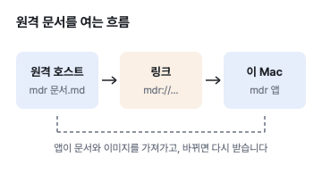

# 원격 문서 확인용

이 문서는 `mdr serve`가 내주는 원격 문서를 앱이 제대로 여는지 확인하는 데 씁니다. 문서 폴더는 이 파일이 있는 `fixtures/remote`입니다.

## 그려져야 하는 것

문서 폴더 안의 이미지는 서버에서 받아 그립니다.

문서 폴더 안의 다른 문서로 가는 링크는 앱에서 열립니다: [둘째 문서](guide/second.md).

## 그려지지 않아야 하는 것

원격 문서의 내용은 믿을 수 없는 입력으로 다룹니다. 아래 이미지는 모두 대체 글자로만 보여야 하고, 앱은 그 주소로 아무 요청도 보내지 않아야 합니다.

- 없는 이미지: 
- 문서 폴더 밖의 이미지: 
- 웹 이미지: 
- 로컬 파일 이미지: 

아래 링크는 눌러도 열리지 않아야 합니다.

- 문서 폴더 밖의 문서: [폴더 밖 문서](../01-korean-handoff.md)
- 이 Mac의 파일: [계산기](file:///System/Applications/Calculator.app)
- 다른 서버의 문서: [다른 서버](mdr://100.64.0.1:6370/token/other.md)
- 마크다운이 아닌 파일: [데이터](data.csv)

웹 링크는 브라우저로 넘깁니다: [example.com](https://example.com).

## 긴 본문

스크롤 위치를 확인하려고 문단을 여러 개 둡니다.

문단 1. 원격 호스트의 팬에서 명령 하나로 문서를 열면, 렌더링은 늘 이 Mac에서 하고 원격 호스트는 파일만 내줍니다. 읽던 자리는 서버가 다시 떠서 링크가 바뀌어도 이어져야 합니다.

문단 2. 원격 호스트의 팬에서 명령 하나로 문서를 열면, 렌더링은 늘 이 Mac에서 하고 원격 호스트는 파일만 내줍니다. 읽던 자리는 서버가 다시 떠서 링크가 바뀌어도 이어져야 합니다.

문단 3. 원격 호스트의 팬에서 명령 하나로 문서를 열면, 렌더링은 늘 이 Mac에서 하고 원격 호스트는 파일만 내줍니다. 읽던 자리는 서버가 다시 떠서 링크가 바뀌어도 이어져야 합니다.

문단 4. 원격 호스트의 팬에서 명령 하나로 문서를 열면, 렌더링은 늘 이 Mac에서 하고 원격 호스트는 파일만 내줍니다. 읽던 자리는 서버가 다시 떠서 링크가 바뀌어도 이어져야 합니다.

문단 5. 원격 호스트의 팬에서 명령 하나로 문서를 열면, 렌더링은 늘 이 Mac에서 하고 원격 호스트는 파일만 내줍니다. 읽던 자리는 서버가 다시 떠서 링크가 바뀌어도 이어져야 합니다.

문단 6. 원격 호스트의 팬에서 명령 하나로 문서를 열면, 렌더링은 늘 이 Mac에서 하고 원격 호스트는 파일만 내줍니다. 읽던 자리는 서버가 다시 떠서 링크가 바뀌어도 이어져야 합니다.

문단 7. 원격 호스트의 팬에서 명령 하나로 문서를 열면, 렌더링은 늘 이 Mac에서 하고 원격 호스트는 파일만 내줍니다. 읽던 자리는 서버가 다시 떠서 링크가 바뀌어도 이어져야 합니다.

문단 8. 원격 호스트의 팬에서 명령 하나로 문서를 열면, 렌더링은 늘 이 Mac에서 하고 원격 호스트는 파일만 내줍니다. 읽던 자리는 서버가 다시 떠서 링크가 바뀌어도 이어져야 합니다.

문단 9. 원격 호스트의 팬에서 명령 하나로 문서를 열면, 렌더링은 늘 이 Mac에서 하고 원격 호스트는 파일만 내줍니다. 읽던 자리는 서버가 다시 떠서 링크가 바뀌어도 이어져야 합니다.

문단 10. 원격 호스트의 팬에서 명령 하나로 문서를 열면, 렌더링은 늘 이 Mac에서 하고 원격 호스트는 파일만 내줍니다. 읽던 자리는 서버가 다시 떠서 링크가 바뀌어도 이어져야 합니다.

문단 11. 원격 호스트의 팬에서 명령 하나로 문서를 열면, 렌더링은 늘 이 Mac에서 하고 원격 호스트는 파일만 내줍니다. 읽던 자리는 서버가 다시 떠서 링크가 바뀌어도 이어져야 합니다.

문단 12. 원격 호스트의 팬에서 명령 하나로 문서를 열면, 렌더링은 늘 이 Mac에서 하고 원격 호스트는 파일만 내줍니다. 읽던 자리는 서버가 다시 떠서 링크가 바뀌어도 이어져야 합니다.

문단 13. 원격 호스트의 팬에서 명령 하나로 문서를 열면, 렌더링은 늘 이 Mac에서 하고 원격 호스트는 파일만 내줍니다. 읽던 자리는 서버가 다시 떠서 링크가 바뀌어도 이어져야 합니다.

문단 14. 원격 호스트의 팬에서 명령 하나로 문서를 열면, 렌더링은 늘 이 Mac에서 하고 원격 호스트는 파일만 내줍니다. 읽던 자리는 서버가 다시 떠서 링크가 바뀌어도 이어져야 합니다.

문단 15. 원격 호스트의 팬에서 명령 하나로 문서를 열면, 렌더링은 늘 이 Mac에서 하고 원격 호스트는 파일만 내줍니다. 읽던 자리는 서버가 다시 떠서 링크가 바뀌어도 이어져야 합니다.

문단 16. 원격 호스트의 팬에서 명령 하나로 문서를 열면, 렌더링은 늘 이 Mac에서 하고 원격 호스트는 파일만 내줍니다. 읽던 자리는 서버가 다시 떠서 링크가 바뀌어도 이어져야 합니다.

문단 17. 원격 호스트의 팬에서 명령 하나로 문서를 열면, 렌더링은 늘 이 Mac에서 하고 원격 호스트는 파일만 내줍니다. 읽던 자리는 서버가 다시 떠서 링크가 바뀌어도 이어져야 합니다.

문단 18. 원격 호스트의 팬에서 명령 하나로 문서를 열면, 렌더링은 늘 이 Mac에서 하고 원격 호스트는 파일만 내줍니다. 읽던 자리는 서버가 다시 떠서 링크가 바뀌어도 이어져야 합니다.

문단 19. 원격 호스트의 팬에서 명령 하나로 문서를 열면, 렌더링은 늘 이 Mac에서 하고 원격 호스트는 파일만 내줍니다. 읽던 자리는 서버가 다시 떠서 링크가 바뀌어도 이어져야 합니다.

문단 20. 원격 호스트의 팬에서 명령 하나로 문서를 열면, 렌더링은 늘 이 Mac에서 하고 원격 호스트는 파일만 내줍니다. 읽던 자리는 서버가 다시 떠서 링크가 바뀌어도 이어져야 합니다.

문단 21. 원격 호스트의 팬에서 명령 하나로 문서를 열면, 렌더링은 늘 이 Mac에서 하고 원격 호스트는 파일만 내줍니다. 읽던 자리는 서버가 다시 떠서 링크가 바뀌어도 이어져야 합니다.

문단 22. 원격 호스트의 팬에서 명령 하나로 문서를 열면, 렌더링은 늘 이 Mac에서 하고 원격 호스트는 파일만 내줍니다. 읽던 자리는 서버가 다시 떠서 링크가 바뀌어도 이어져야 합니다.

문단 23. 원격 호스트의 팬에서 명령 하나로 문서를 열면, 렌더링은 늘 이 Mac에서 하고 원격 호스트는 파일만 내줍니다. 읽던 자리는 서버가 다시 떠서 링크가 바뀌어도 이어져야 합니다.

문단 24. 원격 호스트의 팬에서 명령 하나로 문서를 열면, 렌더링은 늘 이 Mac에서 하고 원격 호스트는 파일만 내줍니다. 읽던 자리는 서버가 다시 떠서 링크가 바뀌어도 이어져야 합니다.

문단 25. 원격 호스트의 팬에서 명령 하나로 문서를 열면, 렌더링은 늘 이 Mac에서 하고 원격 호스트는 파일만 내줍니다. 읽던 자리는 서버가 다시 떠서 링크가 바뀌어도 이어져야 합니다.

문단 26. 원격 호스트의 팬에서 명령 하나로 문서를 열면, 렌더링은 늘 이 Mac에서 하고 원격 호스트는 파일만 내줍니다. 읽던 자리는 서버가 다시 떠서 링크가 바뀌어도 이어져야 합니다.

문단 27. 원격 호스트의 팬에서 명령 하나로 문서를 열면, 렌더링은 늘 이 Mac에서 하고 원격 호스트는 파일만 내줍니다. 읽던 자리는 서버가 다시 떠서 링크가 바뀌어도 이어져야 합니다.

문단 28. 원격 호스트의 팬에서 명령 하나로 문서를 열면, 렌더링은 늘 이 Mac에서 하고 원격 호스트는 파일만 내줍니다. 읽던 자리는 서버가 다시 떠서 링크가 바뀌어도 이어져야 합니다.

문단 29. 원격 호스트의 팬에서 명령 하나로 문서를 열면, 렌더링은 늘 이 Mac에서 하고 원격 호스트는 파일만 내줍니다. 읽던 자리는 서버가 다시 떠서 링크가 바뀌어도 이어져야 합니다.

문단 30. 원격 호스트의 팬에서 명령 하나로 문서를 열면, 렌더링은 늘 이 Mac에서 하고 원격 호스트는 파일만 내줍니다. 읽던 자리는 서버가 다시 떠서 링크가 바뀌어도 이어져야 합니다.

문단 31. 원격 호스트의 팬에서 명령 하나로 문서를 열면, 렌더링은 늘 이 Mac에서 하고 원격 호스트는 파일만 내줍니다. 읽던 자리는 서버가 다시 떠서 링크가 바뀌어도 이어져야 합니다.

문단 32. 원격 호스트의 팬에서 명령 하나로 문서를 열면, 렌더링은 늘 이 Mac에서 하고 원격 호스트는 파일만 내줍니다. 읽던 자리는 서버가 다시 떠서 링크가 바뀌어도 이어져야 합니다.

문단 33. 원격 호스트의 팬에서 명령 하나로 문서를 열면, 렌더링은 늘 이 Mac에서 하고 원격 호스트는 파일만 내줍니다. 읽던 자리는 서버가 다시 떠서 링크가 바뀌어도 이어져야 합니다.

문단 34. 원격 호스트의 팬에서 명령 하나로 문서를 열면, 렌더링은 늘 이 Mac에서 하고 원격 호스트는 파일만 내줍니다. 읽던 자리는 서버가 다시 떠서 링크가 바뀌어도 이어져야 합니다.

문단 35. 원격 호스트의 팬에서 명령 하나로 문서를 열면, 렌더링은 늘 이 Mac에서 하고 원격 호스트는 파일만 내줍니다. 읽던 자리는 서버가 다시 떠서 링크가 바뀌어도 이어져야 합니다.

문단 36. 원격 호스트의 팬에서 명령 하나로 문서를 열면, 렌더링은 늘 이 Mac에서 하고 원격 호스트는 파일만 내줍니다. 읽던 자리는 서버가 다시 떠서 링크가 바뀌어도 이어져야 합니다.

문단 37. 원격 호스트의 팬에서 명령 하나로 문서를 열면, 렌더링은 늘 이 Mac에서 하고 원격 호스트는 파일만 내줍니다. 읽던 자리는 서버가 다시 떠서 링크가 바뀌어도 이어져야 합니다.

문단 38. 원격 호스트의 팬에서 명령 하나로 문서를 열면, 렌더링은 늘 이 Mac에서 하고 원격 호스트는 파일만 내줍니다. 읽던 자리는 서버가 다시 떠서 링크가 바뀌어도 이어져야 합니다.

문단 39. 원격 호스트의 팬에서 명령 하나로 문서를 열면, 렌더링은 늘 이 Mac에서 하고 원격 호스트는 파일만 내줍니다. 읽던 자리는 서버가 다시 떠서 링크가 바뀌어도 이어져야 합니다.

문단 40. 원격 호스트의 팬에서 명령 하나로 문서를 열면, 렌더링은 늘 이 Mac에서 하고 원격 호스트는 파일만 내줍니다. 읽던 자리는 서버가 다시 떠서 링크가 바뀌어도 이어져야 합니다.

## 끝

마지막 절입니다.
